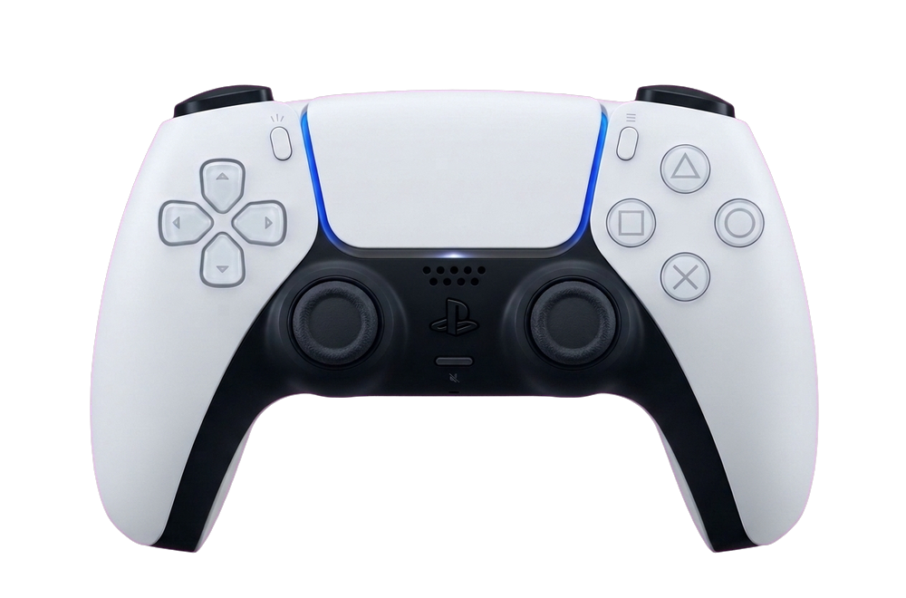
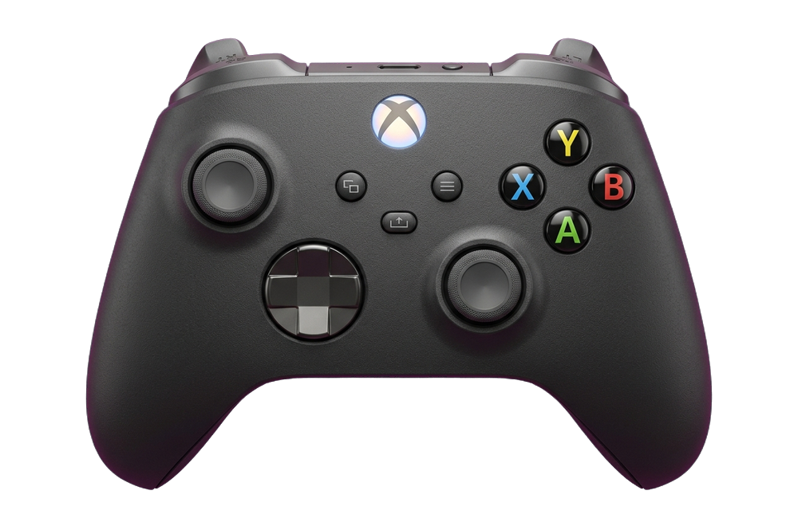

<p align="center">
  
</p>

<h1 align="center">thumbdesk.</h1>

<p align="center">
  <strong>Turn any Xbox or PlayStation controller into a native, 120 Hz Windows desktop input studio.</strong>
</p>

<p align="center">
  <a href="https://orionopenwow.github.io/ThumbDesk/"></a>
  <a href="https://github.com/orionopenwow/ThumbDesk/releases/latest"></a>
  <a href="https://github.com/orionopenwow/ThumbDesk/actions"></a>
  
  <a href="LICENSE"></a>
</p>

---

**thumbdesk.** is a native Windows desktop application built with **Rust + Tauri v2 (Win32 `SendInput`, XInput, Direct USB/BT HID)** and **React 19 + TypeScript**. Inspired by [ggaabe/vibe-controller](https://github.com/ggaabe/vibe-controller) for macOS, it brings full feature parity — dual-stick primary & precision cursors, modifier layers, per-app sparse overrides, dual-motor haptics, Virtual Desktop switching, and Multi-PC LAN Companion handoff — to Windows in a single portable `.exe`.

<p align="center">
  
  
</p>

## Download & Quick Start

1. Download **`ThumbDesk-Windows-x64.zip`** (or standalone **`ThumbDesk.exe`**) from the [Latest Release](https://github.com/orionopenwow/ThumbDesk/releases/latest).
2. Connect an **Xbox** (360 / One / Series X|S) or **PlayStation** (DualSense / DualShock 4, USB or Bluetooth) controller.
3. Run **`ThumbDesk.exe`** — no installer, no drivers, and no external runtime required.

> **Instant local launcher**: If you cloned the repo, double-click **`dev.bat`** to launch the prebuilt standalone `ThumbDesk.exe` with zero compile time (`dev.bat --hot` for live Vite hot-reload, `dev.bat --build` to rebuild, `dev.bat --test` to run all tests).

## Key Features

- **120 Hz Real-Time Cursor Physics (`SendInput`)**: Radial deadzone, exponential response curve, acceleration (`1 + c² × 0.35`), frame-rate independent smoothing, flick boost (`2.0×` throw with `2.0s` linear decay), subpixel remainder accumulation, and cross-edge sweeps (`6000 px/s`).
- **Dynamic Xbox & PlayStation Hardware Detection**:
  - **XInput**: Xbox 360 / One / Series X|S input, battery telemetry, and dual-motor rumble.
  - **Direct HID (`hidapi`)**: Sony DualSense (USB & Bluetooth) and DualShock 4 (USB & Bluetooth), including **Touchpad click** and dual-motor rumble.
  - Automatically hot-swaps 3D studio hardware artwork, button labels, hotspots, and callouts when switching controllers.
- **Modifier Layers & Per-App Sparse Overrides**:
  - Hold `LB`/`L1` or `RB`/`R1` to unlock an entire second layer of shortcuts while preserving normal tap actions (plus `LB + RB` chorded modifiers).
  - Automatic foreground app detection (`GetForegroundWindow`) for per-`.exe` sparse overrides, including a built-in **Codex / ChatGPT Starter** with non-destructive `%USERPROFILE%\.codex\keybindings.json` provisioning.
- **Tactile Haptics Engine**: 7 distinct pulse waveforms (`Soft tap`, `Double tap`, `Thump`, `Left pulse`, `Right pulse`, `Grab & release`, `None`) with left/right motor locality routing, strength scaling, and suggested-pattern presets.
- **Multi-PC LAN Companion Mode**: NDJSON v2 over TCP with automatic UDP LAN discovery for seamless cross-PC pointer, click, scroll, and shortcut handoff.
- **Portable Profiles & macOS `GAPE.json` Import**: Atomic JSON persistence at `%APPDATA%\Vibe Controller\profiles.json` with one-click import/export and automatic macOS `GAPE.json` shortcut conversion.
- **Unified Frameless Studio UI + System Tray**: Draggable top bar, stylized Yellow / Green / Red window controls, 6 shell color finishes, searchable Bindings view, live input diagnostics, and Windows System Tray integration.

## Default Windows Mappings (`Gabe's Defaults`)

| Control | Default Action | Haptic |
| --- | --- | --- |
| **Left Stick** | Primary cursor (`2228 px/s`) | — |
| **Right Stick** | Precision cursor (`566 px/s`) | — |
| **LT / L2** | Left mouse hold (drag) | Grab & release |
| **LB / L1** | `Esc` (tap) / Modifier layer (hold) | Soft tap |
| **RT / R2** | Windows Voice Typing (`Win+H`) | Soft tap |
| **RB / R1** | Right click (tap) / Modifier layer (hold) | Soft tap |
| **A / Cross** | Left click | None |
| **B / Circle** | Area screenshot (`Win+Shift+S` Snipping Tool) | Soft tap |
| **X / Square** | OCR text capture (`Win+Shift+T` Text Extractor) | Double tap |
| **Y / Triangle** | Paste (`Ctrl+V`) | None |
| **D-Pad Up / Down** | Scroll up / down (repeats while held) | None |
| **D-Pad Left / Right** | Switch Virtual Desktop (`Ctrl+Win+Left/Right`) | None |
| **L3 / R3** | `Enter` / `Backspace` | Soft tap / None |
| **View / Create** | Copy (`Ctrl+C`) | None |
| **Menu / Options** | New tab (`Ctrl+T`) | None |
| **Home / PS** | Close tab/window (`Ctrl+W`) | Thump |
| **Share (Xbox)** | Type `/` | None |

## Development & Milestone Releases

```powershell
# Install frontend dependencies
npm install

# Run all unit tests (Vitest + Rust)
.\dev.bat --test

# Run live hot-reload development mode
.\dev.bat --hot

# Package standalone ThumbDesk.exe + ThumbDesk-Windows-x64.zip
.\package-release.bat

# One-click milestone: test + build + commit + push + tag + GitHub Release
.\release-milestone.ps1 -Version "v1.0.1" -Message "Milestone: polish and fixes"
```

## Architecture

- **`src-tauri/src/models/`** — Controls, vibration waveforms, Windows VK + macOS CGKeyCode shortcuts, profiles, and Companion v2 protocol.
- **`src-tauri/src/engines/`** — `CursorMath`, `ActionEngine`, and dedicated `HeldScrollRepeater`.
- **`src-tauri/src/hardware/`** — Win32 `XInput`, `hidapi` DualSense/DS4/Xbox360 parsers, `HapticsEngine`, and `WindowsControllerHub`.
- **`src-tauri/src/platform/`** — Win32 `SendInput` mouse/keyboard/scroll/Virtual Desktop injection and `GetForegroundWindow` active app detection.
- **`src-tauri/src/services/`** — `ProfileStore`, `CodexKeybindingProvisioner`, and Tokio TCP/UDP `CompanionService`.
- **`src/`** — React 19 + TypeScript Obsidian Studio UI with 3D controller renders, horizontal keycap callout pills, and live telemetry.

## Credits & License

Reverse-engineered and natively ported for Windows from [ggaabe/vibe-controller](https://github.com/ggaabe/vibe-controller). Licensed under the [MIT License](LICENSE).
