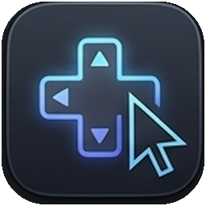
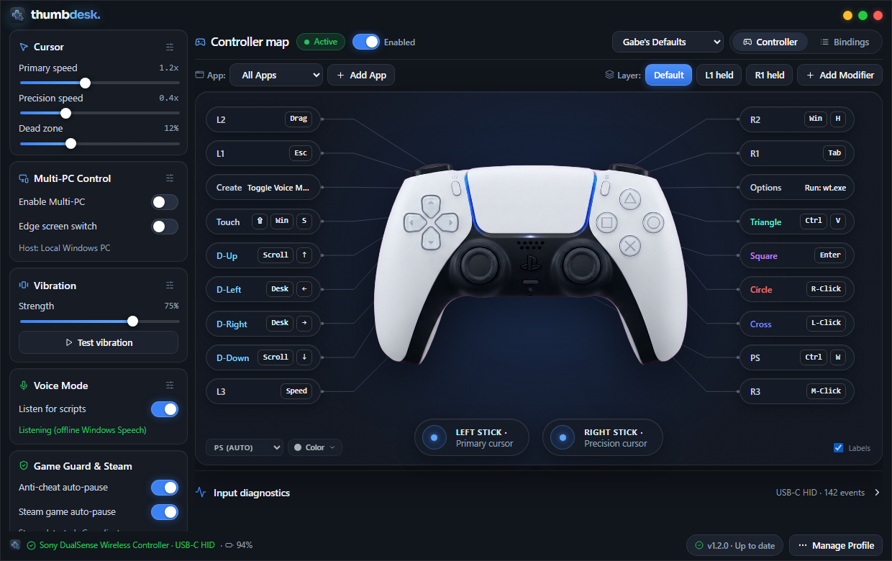
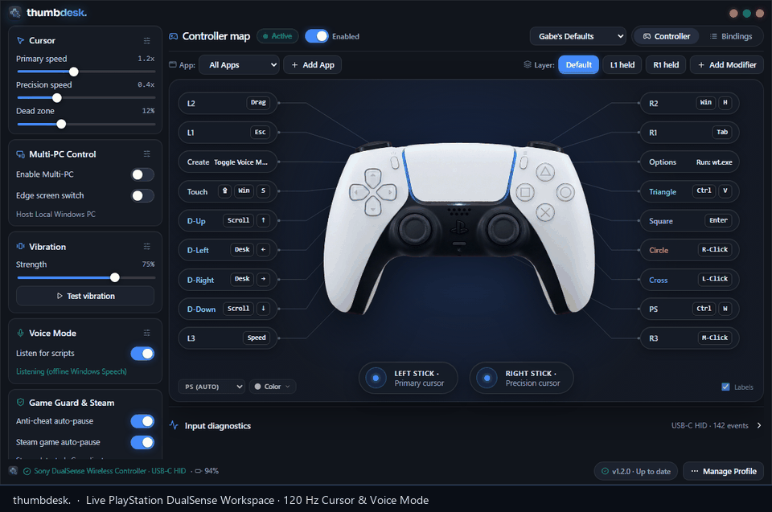

<p align="center">
  
</p>

<h1 align="center">thumbdesk.</h1>

<p align="center">
  <strong>Control your entire Windows PC from an Xbox or PlayStation controller — with voice scripts, custom commands, haptics, and automatic anti-cheat safety.</strong>
</p>

<p align="center">
  <a href="https://orionopenwow.github.io/ThumbDesk/"></a>
  <a href="https://github.com/orionopenwow/ThumbDesk/releases/latest"></a>
  <a href="https://github.com/orionopenwow/ThumbDesk/actions"></a>
  
  <a href="LICENSE"></a>
</p>

---

### What is `thumbdesk.`?

**thumbdesk.** lets you lean back and run your entire Windows desktop from a game controller — no mouse or keyboard required. Move the cursor smoothly at 120 Hz with your thumbsticks, click/drag/scroll, switch Virtual Desktops, trigger keyboard shortcuts, launch **any shell command or `.bat`/PowerShell script** from a button or your voice, and even slide your cursor across the screen edge onto a second Windows PC over LAN.

Built natively in **Rust + Tauri v2 (Win32 `SendInput`, XInput, Direct USB/BT HID)** and **React 19 + TypeScript**, it ships as a **single portable `ThumbDesk.exe`** with zero drivers, zero background bloat, and built-in SHA-256 verified auto-updates.

<p align="center">
  
</p>

### See It In Action

<p align="center">
  
</p>

---

## Download & Quick Start

1. Download **`ThumbDesk.exe`** (standalone) or **`ThumbDesk-Windows-x64.zip`** from the [Latest Release](https://github.com/orionopenwow/ThumbDesk/releases/latest).
2. Plug in or pair an **Xbox** (360 / One / Series X|S) or **PlayStation** (DualSense / DualShock 4, USB or Bluetooth) controller.
3. Launch **`ThumbDesk.exe`** — your controller is detected automatically, the 3D studio layout adapts to your hardware, and you're ready to go.

> **Auto-Updates Built In**: Whenever a newer GitHub Release is published, `thumbdesk.` quietly preloads it in the background, verifies its SHA-256 checksum against `SHA256SUMS.txt`, and lets you click **Restart to Update** from the custom studio installer.

---

## Key Features

### 1. 120 Hz Dual-Stick Cursor & Modifier Layers
- **Primary + Precision Sticks**: Left stick glides fast across monitors (with radial deadzone, exponential curve, flick boost, and subpixel smoothing); right stick gives pixel-accurate precision.
- **Hold-to-Shift Modifier Layers**: Hold `L1`/`LB` or `R1`/`RB` to unlock a second layer of shortcuts while preserving normal tap actions (plus `L1 + R1` chords).
- **Per-App Overrides**: Automatically detects the focused Windows app (`GetForegroundWindow`) so you can bind app-specific shortcuts (includes a built-in **Codex / ChatGPT** starter).

### 2. Voice Mode & Custom Command Scripts
- **Run Any Command or Script from a Button**: Map any controller button (or modifier combo) to **Run Command / Script** to execute `wt.exe`, PowerShell one-liners, Python scripts, or `.bat` files silently without flashing a console window — complete with an in-modal **Test Command** button.
- **Offline Voice Mode**: Toggle **Voice Mode** in the sidebar (or map a button to `Toggle Voice Mode`) to trigger any custom command or script by speaking a phrase, powered by built-in offline Windows Speech Recognition (`System.Speech`) with zero cloud APIs.

### 3. Anti-Cheat Compliance & Steam Integration
- **Automatic Anti-Cheat Guard**: `thumbdesk.` **never** attempts to bypass or inject into protected games. When kernel anti-cheat processes (**Riot Vanguard**, **Easy Anti-Cheat**, **BattlEye**, **FACEIT**, **Ricochet**, **EA AntiCheat**, **nProtect GameGuard**, **XIGNCODE3**) are detected, `thumbdesk.` automatically suspends all synthetic `SendInput` cursor and keyboard output and clearly displays a **Guard** status badge.
- **Steam Game Auto-Pause & Activation**: Automatically pauses desktop input whenever a Steam game (`\steamapps\common\`) takes focus so your controller hands off cleanly to native game / Steam Input. Includes one-click **Steam Input** (`steam://settings/controller`) and **Big Picture** (`steam://open/bigpicture`) launchers right in the sidebar.

### 4. Dynamic Xbox & PlayStation Hardware + Haptics
- **Native XInput + Direct HID (`hidapi`)**: Supports Xbox 360 / One / Series X|S, Sony DualSense (USB & Bluetooth), and DualShock 4 (USB & Bluetooth) — including **Touchpad click**, battery telemetry, and dual-motor rumble.
- **7 Tactile Haptic Waveforms**: `Soft tap`, `Double tap`, `Thump`, `Left pulse`, `Right pulse`, `Grab & release`, and `None`, with left/right handle locality routing and strength scaling.

### 5. Multi-PC LAN Companion Mode & Portable Profiles
- **Cross-PC Edge Handoff**: Push your cursor past a screen edge to seamlessly control a second Windows PC over local LAN TCP/UDP.
- **macOS `GAPE.json` Import**: Atomic JSON profiles stored at `%APPDATA%\Vibe Controller\profiles.json` with one-click import/export and automatic macOS shortcut conversion.

---

## Default Windows Mappings (`Gabe's Defaults`)

| Control | Default Action | Haptic |
| --- | --- | --- |
| **Left Stick** | Primary cursor (`2228 px/s`) | — |
| **Right Stick** | Precision cursor (`566 px/s`) | — |
| **LT / L2** | Left mouse hold (drag) | Grab & release |
| **LB / L1** | `Esc` (tap) / Modifier layer (hold) | Soft tap |
| **RT / R2** | Windows Voice Typing (`Win+H`) | Soft tap |
| **RB / R1** | Right click (tap) / Modifier layer (hold) | Soft tap |
| **A / Cross** | Left click | None |
| **B / Circle** | Area screenshot (`Win+Shift+S`) | Soft tap |
| **X / Square** | OCR text capture (`Win+Shift+T`) | Double tap |
| **Y / Triangle** | Paste (`Ctrl+V`) | None |
| **D-Pad Up / Down** | Scroll up / down (repeats while held) | None |
| **D-Pad Left / Right** | Switch Virtual Desktop (`Ctrl+Win+Left/Right`) | None |
| **L3 / R3** | `Enter` / `Backspace` | Soft tap / None |
| **View / Create** | Copy (`Ctrl+C`) | None |
| **Menu / Options** | New tab (`Ctrl+T`) | None |
| **Home / PS** | Close tab/window (`Ctrl+W`) | Thump |
| **Share (Xbox)** | Type `/` | None |

---

## Development & Milestone Releases

```powershell
# Install frontend dependencies
npm install

# Run all unit tests (Vitest + Rust)
.\dev.bat --test

# Launch prebuilt standalone ThumbDesk.exe immediately
.\dev.bat

# Run live hot-reload development mode
.\dev.bat --hot

# Package standalone ThumbDesk.exe + ThumbDesk-Windows-x64.zip + SHA256SUMS.txt
.\package-release.bat

# One-click milestone: test + build + commit + push + tag + GitHub Release
.\release-milestone.ps1 -Version "v1.2.0" -Message "Milestone summary"
```

## Architecture

- **`src-tauri/src/models/`** — Controls, vibration waveforms, Windows VK + macOS CGKeyCode shortcuts, profiles, and Companion v2 protocol.
- **`src-tauri/src/engines/`** — `CursorMath`, `ActionEngine`, and dedicated `HeldScrollRepeater`.
- **`src-tauri/src/hardware/`** — Win32 `XInput`, `hidapi` DualSense/DS4/Xbox360 parsers, `HapticsEngine`, and `WindowsControllerHub`.
- **`src-tauri/src/platform/`** — Win32 `SendInput` mouse/keyboard/scroll/Virtual Desktop injection and `GetForegroundWindow` active app detection.
- **`src-tauri/src/services/`** — `ProfileStore`, `CodexKeybindingProvisioner`, Tokio TCP/UDP `CompanionService`, `UpdateService` (SHA-256 preloader), `VoiceModeService`, and `game_guard` (Anti-Cheat & Steam compliance).
- **`src/`** — React 19 + TypeScript Obsidian Studio UI with 3D controller renders, horizontal keycap callouts, Voice/Game Guard sidebar, and custom studio updater modal.

## Credits & License

Reverse-engineered and natively ported for Windows from [ggaabe/vibe-controller](https://github.com/ggaabe/vibe-controller). Licensed under the [MIT License](LICENSE).
